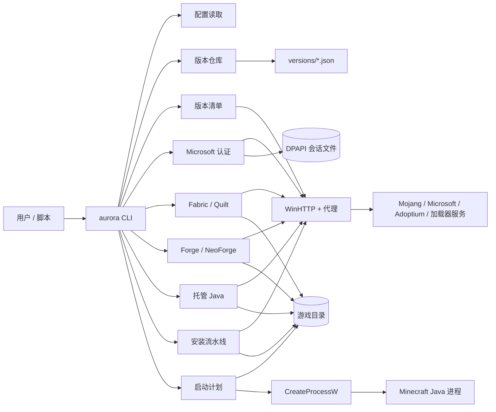
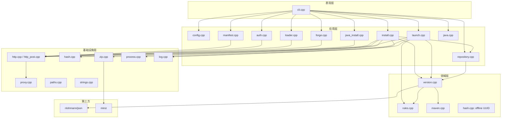
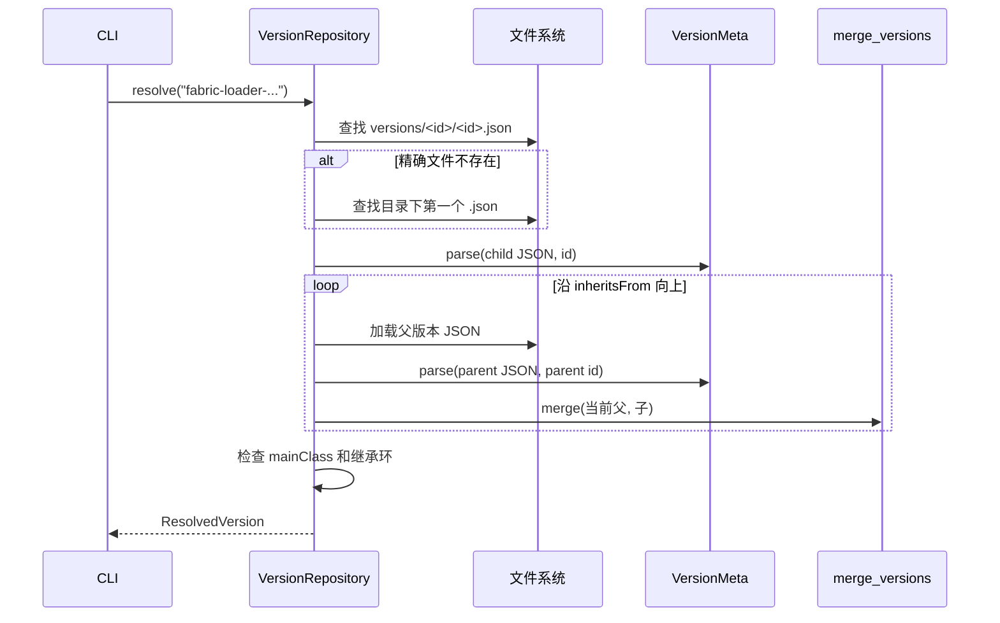
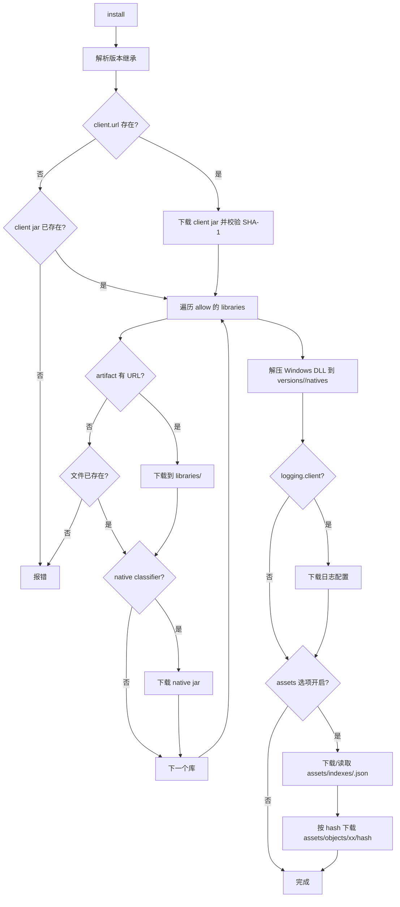
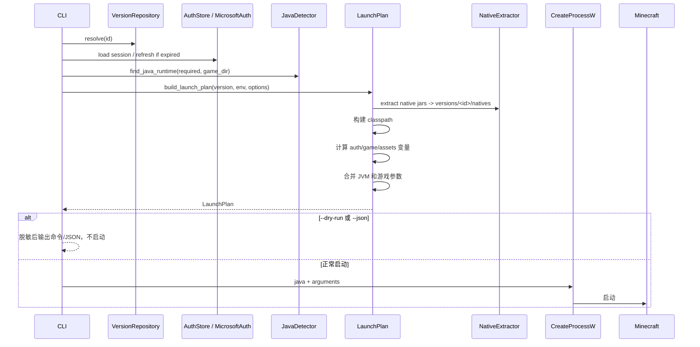
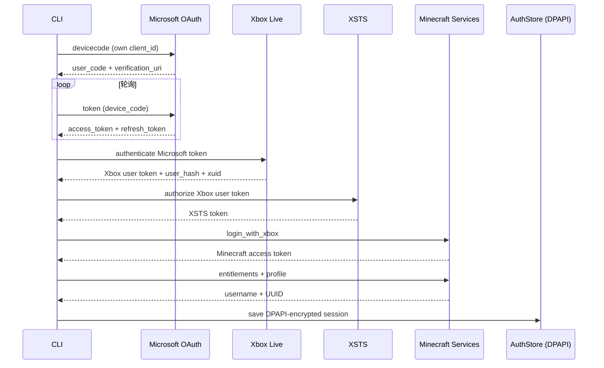
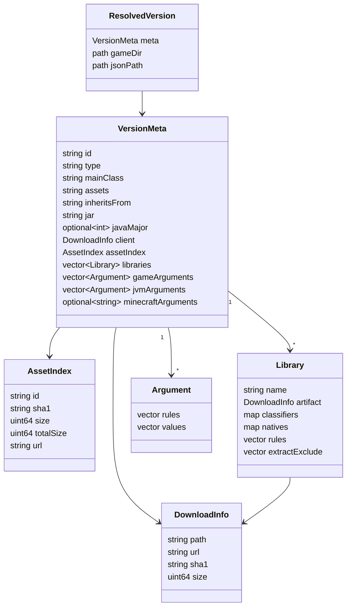

# AuroraLauncher C++ Core 架构

本文描述当前工作区中**已经实现的 C++ 核心**，不是 Java 版 HMCL/AuroraLauncher 的完整功能说明。原 Java 工程已归档到：

```text
D:\AuroraLauncher-archive\2026-10-26\HMCL-main
```

当前工程是 Windows-first、无 GUI 的启动核心。所有“已实现”描述都以本仓库源码为准；产品身份、OAuth 应用和签名边界见 `SIGNING.md`。

## 1. 状态定义

| 标记 | 含义 |
| --- | --- |
| 已实现 | 已有可编译、可运行的代码路径，并有单元测试或现场 CLI 验证 |
| 部分实现 | 主路径存在，但缺少边界处理、平台支持或完整现场验证 |
| 未接入 | 只有接口、文档或占位，没有端到端能力 |

## 2. 系统上下文



边界：

- 输入是用户已有的 `.minecraft` 目录；版本 JSON 可由 `version fetch` 显式从 Mojang 清单获取，`--no-fetch` 可关闭该行为。
- Microsoft 登录只使用项目自己的 Azure 应用 client ID；未配置时拒绝登录，不冒用其他启动器。
- Forge/NeoForge 使用官方 installer；本项目不重新实现其处理器逻辑，也不在启动时隐式联网。
- GUI、整合包、模组依赖解析、资源包、主题包和服务端模块不在当前边界内。

## 3. 分层与模块



关键文件：

| 文件 | 职责 |
| --- | --- |
| `src/cli.cpp` | 命令、参数、JSON/文本输出、敏感参数脱敏 |
| `src/core/repository.cpp` | 扫描 `versions`，加载并递归解析 `inheritsFrom` |
| `src/core/version.cpp` | 版本 JSON 模型、库、参数、下载信息、合并规则 |
| `src/core/rules.cpp` | OS/arch/version/features 规则判断 |
| `src/core/manifest.cpp` | Mojang 版本清单解析与版本 JSON 下载 |
| `src/core/maven.cpp` | Maven 坐标转换和相对路径 |
| `src/core/java.cpp` | Windows Java 候选发现、`release` 解析、托管运行时扫描 |
| `src/core/java_install.cpp` | Adoptium API、SHA-256、ZIP 解压与原子安装 |
| `src/core/install.cpp` | 客户端、库、natives、资源索引和资源对象下载 |
| `src/core/launch.cpp` | 类路径、变量替换、JVM/游戏参数、启动计划 |
| `src/core/auth.cpp` | 设备码、Xbox Live、XSTS、Minecraft 登录、DPAPI 存储 |
| `src/core/loader.cpp` | Fabric/Quilt 元数据查询和 profile JSON 安装 |
| `src/core/forge.cpp` | Forge/NeoForge 版本查询、installer 下载/校验/执行、产物定位 |
| `src/core/http.cpp` | WinHTTP GET、重试、镜像、断点续传 |
| `src/core/http_post.cpp` | WinHTTP POST（认证） |
| `src/core/proxy.cpp` | 环境变量与 WinINET/PAC 代理解析 |
| `src/core/zip.cpp` | miniz 解压，带路径穿越防护 |
| `src/core/hash.cpp` | BCrypt SHA-1/SHA-256/MD5、文件哈希、离线 UUID |
| `src/core/process.cpp` | `CreateProcessW` 启动、等待、输出重定向 |
| `src/core/config.cpp` | `%APPDATA%\AuroraLauncher\config.json` |

## 4. 版本解析



实现细节：

- `versions/<id>/<id>.json` 优先；找不到时使用目录中按文件名排序的第一个 `.json`。
- 继承链按“最底层父版本 → 子版本”合并。
- 子版本非空字段覆盖父版本；库按 `name` 去重，子版本同坐标替换父版本。
- 游戏参数和 JVM 参数按父 → 子追加。
- `assetIndex`、`client`、`javaVersion.majorVersion` 子版本优先。
- 合并后把版本 id 固定为请求的目录 id，避免 JSON 内部 id 与目录名不一致。
- 继承环会报错，不会无限递归。

## 5. 版本清单与安装流水线

`version fetch` 先拉取 Mojang `version_manifest_v2.json`，按 id 找到条目，下载并校验版本 JSON 到 `versions/<id>/<id>.json`。`install` 和 `launch --install` 在本地缺少版本 JSON 时也会走同一路径；显式 `--no-fetch` 可禁止联网。



实现范围：

- 并行资源下载使用最多 8 个工作线程；库下载当前串行。
- 所有带 SHA-1 的下载都会校验；已存在且哈希一致的文件会跳过。
- 资源对象 URL 固定为 `https://resources.download.minecraft.net/<前两位>/<hash>`。
- 下载支持重试、指数退避、`Retry-After`、镜像回退和 `.part` 断点续传；可通过配置/CLI 覆盖。
- 支持旧版资源索引的 `virtual`/`map_to_resources`：安装时复制到 `assets/virtual/<index>/` 或 `<game>/resources/`，启动时把 `game_assets` 指向实际目录。
- 版本 `logging.client` 配置文件会下载并在启动命令中注入。

## 6. 启动流水线



模板变量支持：

`auth_player_name`、`version_name`、`game_directory`、`assets_root`、`game_assets`、`assets_index_name`、`auth_uuid`、`auth_access_token`、`auth_session`、`clientid`、`auth_xuid`、`user_type`、`version_type`、`natives_directory`、`launcher_name`、`launcher_version`、`classpath`、`classpath_separator`、`library_directory`、`resolution_width`、`resolution_height`、`user_properties`。

参数策略：

- 优先使用版本 JSON 的 `arguments.jvm` / `arguments.game`。
- 没有 `arguments` 时回退到旧版 `minecraftArguments` 字符串。
- 总是加入内存参数和 `-Dfile.encoding=UTF-8`。
- 缺少 `-Djava.library.path`、`-cp`/`-classpath` 时补默认值。
- 离线启动使用 `auth_access_token=0`、`user_type=legacy` 和离线 UUID。
- 正版启动使用 Microsoft 会话的 access token、Minecraft UUID、`user_type=msa`，并在可用时附加 `xuid` / `clientId`。
- 启动进程不再记录命令行；`--dry-run` / `--json` 会对 `--accessToken`、`--session` 及其 `=` 形式脱敏。
- Java 选择同时扫描系统 JDK 和 `<game-dir>/runtime/java` 下的托管运行时。

## 7. Microsoft 认证



- OAuth client ID 必须由调用方提供，代码中没有内置任何启动器的 client ID。
- 刷新令牌和 Minecraft 会话写入 `%APPDATA%\AuroraLauncher\auth.dat`，使用当前 Windows 用户的 DPAPI 加密；不能跨用户/机器解密。
- 会话过期时 `launch` 会尝试用 refresh token 刷新；刷新失败则要求重新登录或使用 `--offline`。
- 设备码、访问令牌和刷新令牌不会打印；`auth status --json` 只输出用户名、UUID、类型和过期时间。

## 8. 加载器与托管 Java

### Fabric / Quilt

- 查询元数据：Fabric v2 / Quilt v3 loader 列表，选择 stable 或 latest。
- 下载官方 profile JSON，校验 `id`、`inheritsFrom`、`mainClass`、`libraries`，把 `id` 改写为本地确定性 id（如 `fabric-loader-0.16.10-1.21.1`）。
- 写入 `versions/<id>/<id>.json`；默认不覆盖已有文件，`--force` 才覆盖。
- 生成的版本沿用现有 `inheritsFrom` 合并、安装和启动流程，不需要额外的加载器注入器。

### Forge / NeoForge

- Forge 版本通过官方 `promotions_slim.json` 按 recommended/latest 选择；NeoForge 通过官方 Maven `maven-metadata.xml` 按 Minecraft 版本前缀选择。
- 下载官方 installer JAR，优先读取 Maven `.sha1` sidecar 校验；没有 sidecar 时必须显式 `--allow-unverified` 才能执行。
- 执行前验证 JAR 布局（manifest/install_profile/version），以 `-Djava.awt.headless=true -Djava.net.useSystemProxies=true -jar <installer> --installClient <game>` 运行，stdin 指向 NUL，stdout/stderr 写入日志。
- 安装后扫描 `versions/*/*.json`，按 `inheritsFrom`、`mainClass` 和加载器版本定位产物；不会把安装器输出当成成功，退出码和产物都要验证。

### 托管 Java

- Adoptium latest API 选择 Windows x64 JDK；校验 SHA-256 和大小，miniz 解压，拒绝路径穿越。
- 先解压到 `.staging-*`，验证 `bin/java.exe` 和 `release` 后再原子替换到 `<game-dir>/runtime/java/<jdk>`；失败保留原运行时。
- `java install` 默认 Java 21；`--force` 才替换已有同版本运行时。

## 9. 数据模型



路径约定：

```text
<gameDir>/
  versions/<id>/<id>.json
  versions/<id>/<id>.jar          # client jar；版本 JSON 的 jar 字段可覆盖名字
  versions/<id>/natives/          # 原生 DLL 解压目录
  libraries/                      # Maven 布局
  assets/indexes/<index>.json
  assets/objects/<xx>/<sha1>
  runtime/java/<jdk>/             # 托管 Java
  .aurora/forge/                  # Forge/NeoForge installer 和日志
```

## 10. 当前实现状态

| 模块 | 状态 | 备注 |
| --- | --- | --- |
| CLI | 已实现 | 版本、Java、加载器、Forge、认证、安装、启动、配置 |
| 配置 | 已实现（基础） | JSON 读写；相对路径按当前工作目录解析 |
| 版本仓库 | 已实现 | 本地 JSON、继承、环检测 |
| 版本清单 | 已实现 | Mojang 清单、版本 JSON 下载与 SHA-1 |
| 规则 | 已实现 | Windows/OSX/Linux、arch、features、版本正则 |
| Java 检测 | 已实现（Windows） | 注册表、JAVA_HOME、PATH、常见目录、托管运行时 |
| 托管 Java 安装 | 已实现 | Adoptium、SHA-256、原子替换；真实大包下载待现场验证 |
| 离线登录 | 已实现 | 离线 UUID 和 legacy 参数 |
| Microsoft 登录 | 已实现（需自有 client ID） | 设备码/Xbox/XSTS/Minecraft + DPAPI；现场登录待验证 |
| 下载 | 已实现 | 重试、退避、镜像、断点续传、代理、SHA-1 |
| 安装 | 部分实现 | 客户端/库/natives/objects/logging；无 virtual assets |
| 原生库解压 | 已实现（Windows） | 只解压 `.dll` |
| 启动 | 部分实现 | 离线/正版参数、启动计划、进程启动；真实游戏启动待验证 |
| Fabric / Quilt | 已实现 | 元数据与 profile 安装；API 现场连通性受网络影响 |
| Forge / NeoForge | 已实现（installer bridge） | 官方 installer；真实安装/启动待现场验证 |
| 自签开发签名 | 已实现 | 脚本 + Windows 资源/清单；公开发布需可信证书 |
| GUI | 未接入 | 当前只有 CLI |
| 模组/整合包/主题/服务端 | 未接入 | 原 Java 功能尚未迁移 |

## 11. 关键设计决策

1. **先核心、后 UI**：CLI 直接复用未来 GUI 会调用的模块，避免先做界面后补核心。
2. **显式网络行为**：版本清单只在 `version fetch`、`install` 缺少本地 JSON 或显式允许时拉取；`--no-fetch` 可完全关闭。Forge/NeoForge 安装器只在显式命令中执行。
3. **显式下载模型**：`DownloadInfo` 保留 URL、SHA-1、size、Maven path；安装器只根据模型执行。
4. **继承在内存中合并**：不修改原始 JSON；每次解析得到独立 `VersionMeta`。
5. **自有身份**：产品名、User-Agent、配置目录、启动器品牌和 OAuth 应用 ID 都是 AuroraLauncher 自己的，不使用其他启动器的身份。
6. **Windows 原生基础设施**：WinHTTP、BCrypt、DPAPI、`CreateProcessW`、注册表；代价是跨平台移植成本。
7. **第三方安装器只做编排**：Forge/NeoForge 的处理器逻辑交给官方 installer，项目只负责选择版本、校验下载、执行和验证产物。

## 12. 风险

### P0

- **令牌泄露**：Minecraft access token 会出现在子进程命令行中，这是 Minecraft 协议决定的；项目已避免记录命令行、对 dry-run JSON 脱敏，但同一用户下的进程查看工具仍可能读取命令行。不得把令牌写入日志、崩溃报告或配置。
- **第三方 installer 执行**：Forge/NeoForge installer 是第三方代码。默认要求 SHA-1 sidecar；`--allow-unverified` 是显式的风险开关。安装器仍会以当前用户权限运行，不能视为沙箱。
- **路径与命令注入**：启动参数通过 `quote_windows_arg` 拼接；库/客户端/资源相对路径和 ZIP 条目已有绝对路径、盘符、`..`、尾随点/空格检查。新增写入路径必须走 containment 检查。
- **OAuth 身份**：不能使用 HMCL 或其他启动器的 client ID；发布前必须注册项目自己的 Azure 应用。

### P1

- **未现场验证**：Microsoft 登录、真实游戏启动、Forge/NeoForge 完整安装、Fabric/Quilt 现场 API 都还没有端到端验证；当前只能保证单元测试和部分联网查询。
- **命令行长度**：没有 argfile/classpath manifest；大量模组导致命令行超过 Windows 限制时会启动失败。
- **Java 选择**：只按 major 选择最低可用版本；没有厂商/位数/内存参数兼容性判断。
- **FIPS/BCrypt**：离线 UUID 使用 BCrypt MD5；在禁用 MD5 的 FIPS 策略下可能失败。
- **并发下载错误**：资源下载并发时只保留第一个错误；部分线程可能已经写入临时文件。
- **代理与 TLS**：系统代理/PAC 已支持；如果代理使用自签 CA，需由系统证书存储信任，项目不做证书校验绕过。
- **配置路径**：相对路径按当前工作目录解析，没有按配置文件所在目录解析。

### P2

- 没有结构化日志文件轮转；`--verbose` 只影响 stderr。
- 没有下载进度条；资源下载只每 250 个输出一次。
- 没有 CLI 自动补全、国际化、退出码细分。
- 没有 CMake install/打包规则；当前只产出 `build/<Config>/aurora.exe`。
- Java 安装尚未做 Adoptium 之外的厂商镜像选择。

## 13. 验证

已执行：

```powershell
cmake -S . -B build -G "Visual Studio 17 2022" -A x64
cmake --build build --config Debug --parallel
ctest --test-dir build -C Debug --output-on-failure
```

结果：

- Debug 编译通过；7 个测试目标全部通过：核心、HTTP、加载器、版本清单、认证、Java 安装、Forge/NeoForge。
- 现场联网：`version latest` 拉取 Mojang 清单成功；`forge list forge 1.21.1` 拉取官方 promotions 成功。
- 启动计划测试覆盖空 `clientid`/`auth_xuid` 参数保留和单次变量替换。
- 路径安全测试覆盖绝对路径、盘符、`..`、ADS/冒号和危险尾随点/空格。
- 使用归档中的 `1.0` 版本执行了 `version list`、`version show` 和 `launch --dry-run`；中文路径、用户名和版本 id 已验证。
- 使用本地临时 HTTP 服务验证了客户端 JAR、库、资源索引和 native ZIP 下载，以及 SHA-1 校验、`.part` 文件、`extract.exclude` 和 `.dll` 解压。
- 未执行真实游戏启动、Microsoft 登录、完整 Forge/NeoForge 安装和 GUI 验证。
- 本机代理对 `meta.fabricmc.net`、`maven.neoforged.net` 的连通性不稳定，Fabric/NeoForge 现场查询待换网络复测。

## 14. 后续阶段

1. **GUI**：在核心 API 稳定后选择 Qt 6 或其他桌面框架，迁移原 Java 页面。
2. **整合包**：CurseForge/Modrinth 格式解析、文件覆盖、依赖安装。
3. **模组/资源包**：模组扫描、依赖解析、启用/禁用、资源包管理。
4. **服务端/更新器**：服务端启动、更新检查、崩溃分析。
5. **兼容层**：旧版 `virtual`/`map_to_resources` 资源、主题包、其他原 HMCL 功能。
6. **发布工程**：可信代码签名、CI 构建、安装包和自动更新。

在完成第 1～4 阶段前，不应把当前工程描述为“完整替代原启动器”。
