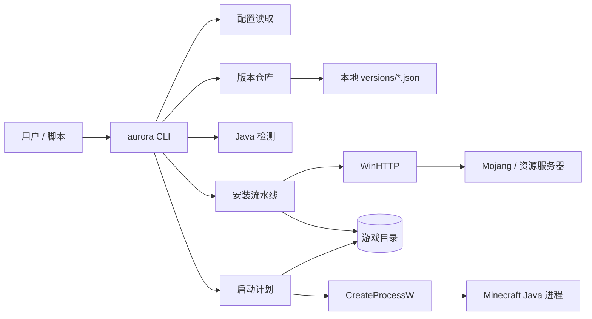
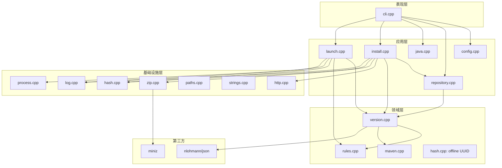
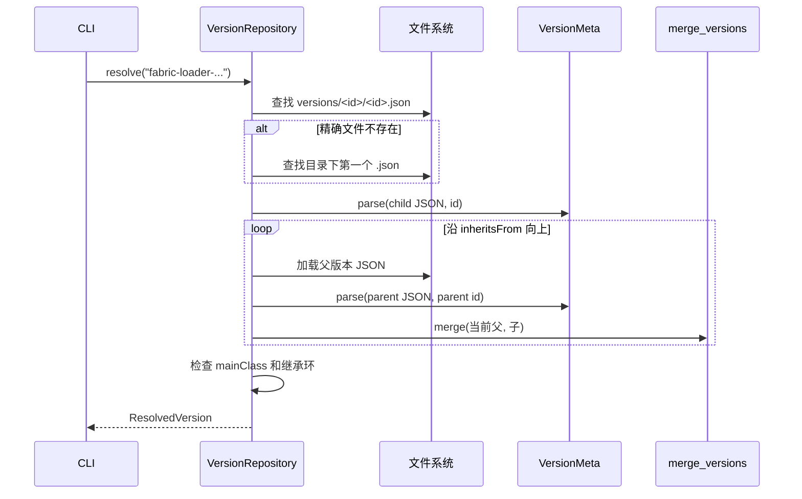
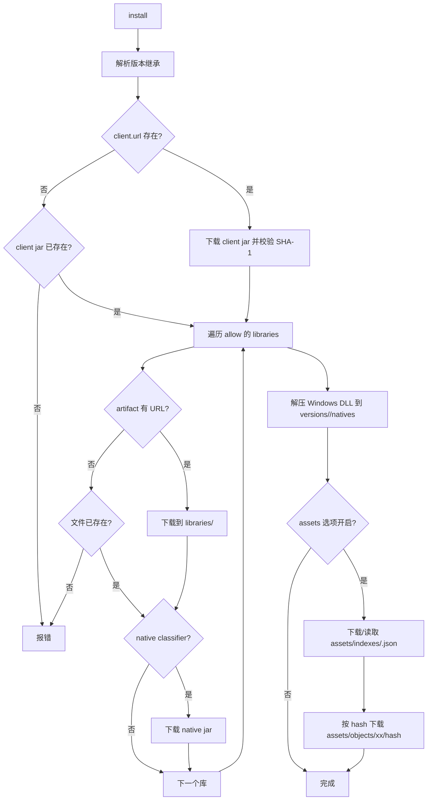
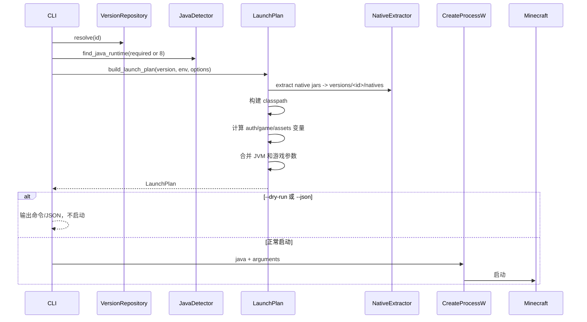
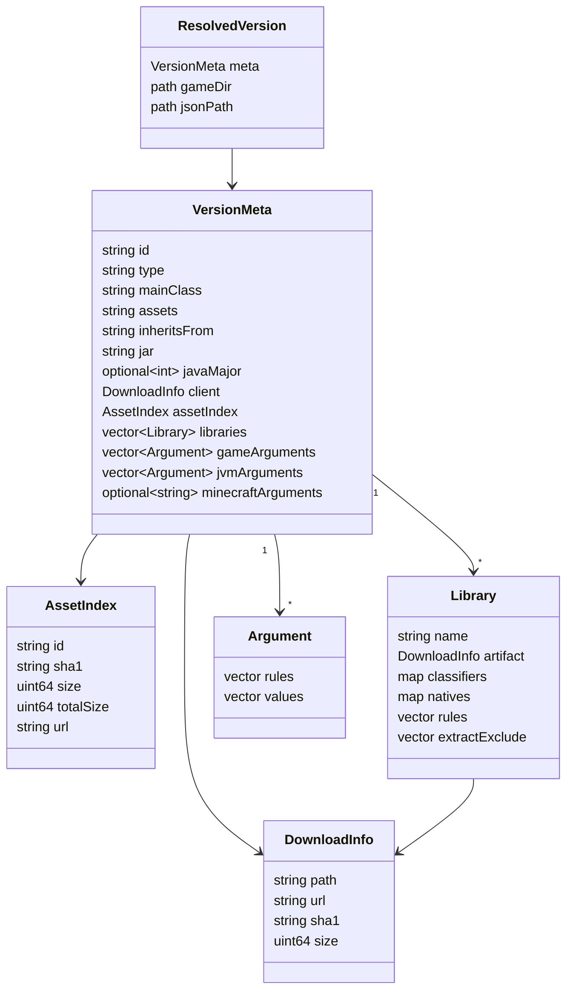

# AuroraLauncher C++ Core 架构

本文描述当前工作区中**已经实现的 C++ 核心**，不是 Java 版 HMCL/AuroraLauncher 的完整功能说明。原 Java 工程已归档到：

```text
D:\AuroraLauncher-archive\2026-10-26\HMCL-main
```

当前工程是 Windows-first、无 GUI 的启动核心。所有“已实现”描述都以本仓库源码为准。

## 1. 状态定义

| 标记 | 含义 |
| --- | --- |
| 已实现 | 已有可编译、可运行的代码路径，并有基础测试或 CLI 验证 |
| 部分实现 | 主路径存在，但缺少边界处理、平台支持或完整功能 |
| 未接入 | 只有接口、文档或占位，没有端到端能力 |

## 2. 系统上下文



边界：

- 输入是用户已有的 `.minecraft` 目录和本地版本 JSON。
- 不负责从 Mojang 版本清单创建版本目录。
- 当前不连接 Microsoft/Xbox 认证服务，只生成离线账号参数。
- GUI、模组加载器、整合包、主题和服务端模块不在当前边界内。

## 3. 分层与模块



关键文件：

| 文件 | 职责 |
| --- | --- |
| `src/cli.cpp` | 命令、参数、JSON/文本输出 |
| `src/core/repository.cpp` | 扫描 `versions`，加载并递归解析 `inheritsFrom` |
| `src/core/version.cpp` | 版本 JSON 模型、库、参数、下载信息、合并规则 |
| `src/core/rules.cpp` | OS/arch/version/features 规则判断 |
| `src/core/maven.cpp` | Maven 坐标转换和相对路径 |
| `src/core/java.cpp` | Windows Java 候选发现和 `release` 文件解析 |
| `src/core/install.cpp` | 客户端、库、natives、资源索引和资源对象下载 |
| `src/core/launch.cpp` | 类路径、变量替换、JVM/游戏参数、启动计划 |
| `src/core/http.cpp` | WinHTTP GET 和带 SHA-1 校验的文件下载 |
| `src/core/zip.cpp` | miniz 内存解压，带路径穿越防护 |
| `src/core/hash.cpp` | BCrypt SHA-1/MD5、文件哈希、离线 UUID |
| `src/core/process.cpp` | `CreateProcessW` 启动和等待 |
| `src/core/config.cpp` | `%APPDATA%\AuroraLauncher\config.json` |

## 4. 版本解析



实现细节：

- `versions/<id>/<id>.json` 优先；找不到时使用目录中按文件名排序的第一个 `.json`。
- 继承链按“最底层父版本 → 子版本”合并。
- 子版本非空字段覆盖父版本；库按 `name` 去重，子版本同坐标替换父版本。
- 游戏参数和 JVM 参数按父 → 子追加。
- `assetIndex`、`client`、`javaVersion.majorVersion` 子版本优先。
- 合并后把版本 id 固定为请求的目录 id，避免 JSON 内部 id 与目录名不一致。
- 继承环会报错，不会无限递归。

## 5. 安装流水线



实现范围：

- 并行资源下载使用最多 8 个工作线程；库下载当前串行。
- 所有带 SHA-1 的下载都会校验；已存在且哈希一致的文件会跳过。
- 资源对象 URL 固定为 `https://resources.download.minecraft.net/<前两位>/<hash>`。
- 未实现镜像源、限速、重试退避和断点续传；临时文件为 `.part`，失败会删除。
- 未处理资源索引的 `virtual`/`map_to_resources`。
- 未处理旧版 `--assetsDir` 的虚拟资源复制。

## 6. 启动流水线



模板变量支持：

`auth_player_name`、`version_name`、`game_directory`、`assets_root`、`game_assets`、`assets_index_name`、`auth_uuid`、`auth_access_token`、`auth_session`、`clientid`、`auth_xuid`、`user_type`、`version_type`、`natives_directory`、`launcher_name`、`launcher_version`、`classpath`、`classpath_separator`、`library_directory`、`resolution_width`、`resolution_height`、`user_properties`。

参数策略：

- 优先使用版本 JSON 的 `arguments.jvm` / `arguments.game`。
- 没有 `arguments` 时回退到旧版 `minecraftArguments` 字符串。
- 总是加入内存参数和 `-Dfile.encoding=UTF-8`。
- 缺少 `-Djava.library.path`、`-cp`/`-classpath` 时补默认值。
- 缺少 `--username`、`--version`、`--gameDir`、`--assetsDir`、`--assetIndex`、`--uuid`、`--accessToken`、`--userType`、`--versionType` 时补离线参数。
- 当前 `auth_access_token` 固定为 `0`，`user_type` 为 `legacy`，仅适用于离线启动。

## 7. 数据模型



路径约定：

```text
<gameDir>/
  versions/<id>/<id>.json
  versions/<id>/<id>.jar          # client jar；版本 JSON 的 jar 字段可覆盖名字
  versions/<id>/natives/          # 原生 DLL 解压目录
  libraries/                      # Maven 布局
  assets/indexes/<index>.json
  assets/objects/<xx>/<sha1>
```

## 8. 离线账号

当前只有一个账号实现：

```text
UUID = MD5("OfflinePlayer:" + username)
version = 3
variant = IETF
```

使用 Windows BCrypt 计算 MD5，并把 UUID 以带连字符的形式传给游戏。已知向量：

```text
Notch       -> b50ad385-829d-3141-a216-7e7d7539ba7f
TestPlayer  -> bb77495a-a740-3169-a238-69654c8bd2c1
```

Microsoft 登录所需的 OAuth、Xbox Live、XSTS、Minecraft access token 和刷新令牌链路均未实现；不会伪造登录成功。

## 9. 当前实现状态

| 模块 | 状态 | 备注 |
| --- | --- | --- |
| CLI | 部分实现 | 命令足够验证核心；帮助和错误信息持续补齐 |
| 配置 | 部分实现 | JSON 读写；相对路径按当前工作目录解析 |
| 版本仓库 | 已实现 | 本地 JSON、继承、环检测 |
| 规则 | 已实现 | Windows/OSX/Linux、arch、features、版本正则 |
| Java 检测 | 部分实现（Windows） | 依赖 `release` 文件；按 major 选最低可用版本；没有自动下载 JRE |
| 离线登录 | 已实现 | 仅离线 |
| Microsoft 登录 | 未接入 | 没有令牌链路 |
| 下载 | 部分实现 | WinHTTP + SHA-1；无重试/镜像/限速 |
| 安装 | 部分实现 | 客户端/库/natives/objects；无 virtual assets |
| 原生库解压 | 已实现（Windows） | 只解压 `.dll` |
| 启动 | 部分实现 | 无模组加载器、无正版认证、无 quick play |
| GUI | 未接入 | 当前只有 CLI |
| 模组/整合包/主题/服务端 | 未接入 | 原 Java 功能尚未迁移 |

## 10. 关键设计决策

1. **先核心、后 UI**：CLI 直接复用未来 GUI 会调用的 `VersionRepository`、`install_version`、`LaunchPlan`，避免先做界面后补核心。
2. **本地版本优先**：不在核心中偷偷拉取版本清单。版本安装和启动都要求本地 JSON 已存在，降低网络和合规复杂度。
3. **显式下载模型**：`DownloadInfo` 保留 URL、SHA-1、size、Maven path，安装器只根据模型执行，不把网络逻辑塞进版本解析。
4. **继承在内存中合并**：不修改原始 JSON；每次解析得到独立 `VersionMeta`，便于后续做版本差异和调试。
5. **Windows 原生基础设施**：WinHTTP、BCrypt、`CreateProcessW`、注册表减少第三方依赖；代价是跨平台移植成本。
6. **第三方库最小化**：JSON 用单头 nlohmann/json，ZIP 用 miniz；两者都保留许可证。

## 11. 风险

### P0

- **离线/正版语义**：当前启动参数固定离线 token。若未来接入正版登录，必须引入完整会话模型，不能只替换 `--accessToken`。
- **路径与命令注入**：启动参数通过 Windows 命令行引用函数拼接；库/客户端/资源相对路径和 ZIP 条目已有拒绝绝对路径、盘符、`..` 和危险尾随点/空格的检查。新增写入路径必须走 `checked_relative_path` 或等价的 containment 检查，新增命令行参数必须走 `quote_windows_arg`，不能直接字符串拼接。
- **下载完整性**：带 SHA-1 的资源会校验；无 SHA-1 的自定义库目前只检查存在性，不能视为安全校验。
- **删除/迁移**：原 Java 工程已移出工作区；后续不要覆盖归档目录，尤其是未提交的 JFoenix 改动。

### P1

- **旧版资源布局**：只支持 `objects`，旧版 `virtual`/`map_to_resources` 版本可能无法正确启动。
- **版本日志配置**：未下载版本 JSON 的 `logging.client` 文件，也未注入对应 `-Dlog4j.configurationFile` 参数；部分版本日志配置会缺失。
- **命令行长度**：没有使用 argfile/classpath manifest；大量模组导致命令行超过 Windows 限制时会启动失败。
- **Java 选择**：只按 major 选择最低可用版本；没有厂商/位数/内存参数兼容性判断。
- **FIPS/BCrypt**：离线 UUID 使用 BCrypt MD5；在禁用 MD5 的 FIPS 策略下可能失败，目前没有可移植 MD5 回退。
- **原生库过滤**：Windows 只解压 `.dll`，其他平台尚未验证；`extract.exclude` 已应用，但过滤规则仍需更多真实版本验证。
- **并发下载错误**：资源下载并发时只保留第一个错误；部分线程可能已经写入临时文件，但没有重试和限速。
- **配置路径**：相对路径按当前工作目录解析，没有按配置文件所在目录解析。
- **HTTP 重定向/代理**：已拒绝 HTTPS→HTTP 降级，仍依赖 WinHTTP 默认代理，没有显式代理配置和超时细分。

### P2

- 没有结构化日志文件轮转；`--verbose` 只影响 stderr。
- 没有下载进度条；资源下载只每 250 个输出一次。
- 没有 CLI 自动补全、国际化、退出码细分。
- 没有 CMake install/打包规则；当前只产出 `build/Debug/aurora.exe`。
- 没有 Git 仓库初始化/提交；当前 C++ 工程未纳入版本控制。

## 12. 验证

已执行：

```powershell
cmake -S . -B build -G "Visual Studio 17 2022" -A x64
cmake --build build --config Debug --parallel
ctest --test-dir build -C Debug --output-on-failure
```

结果：

- Debug 和 Release 编译通过。
- `aurora_tests` 通过，覆盖字符串、Maven、SHA-1/离线 UUID、规则、版本继承、启动计划、ZIP 解压。
- 启动计划测试覆盖空 `clientid`/`auth_xuid` 参数保留和单次变量替换。
- 路径安全测试覆盖绝对路径、盘符、`..`、ADS/冒号和危险尾随点/空格。
- 使用归档中的 `1.0` 版本执行了 `version list`、`version show` 和 `launch --dry-run`，能够生成类路径和完整命令。
- 使用中文游戏目录、中文用户名和中文版本 id 验证了 `version list`、`version show` 和 `launch --dry-run`。
- 使用本地临时 HTTP 服务验证了客户端 JAR、库、资源索引和 native ZIP 下载，以及 SHA-1 校验、`.part` 文件、`extract.exclude` 和 `.dll` 解压。
- 未执行真实 Mojang 下载、真实游戏启动、Microsoft 登录和 GUI 验证。

## 13. 后续阶段

1. **核心稳定化**：补充版本清单拉取、资源 virtual 布局、下载重试/镜像、错误码和日志。
2. **认证**：Microsoft OAuth 设备码 → Xbox Live → XSTS → Minecraft 登录，安全保存 refresh token。
3. **模组加载器**：Fabric/Quilt/Forge/NeoForge 安装与启动链。
4. **整合包**：CurseForge/Modrinth 格式解析、文件覆盖、依赖安装。
5. **GUI**：在核心 API 稳定后选择 Qt 6 或其他桌面框架，迁移原 Java 页面。
6. **兼容层**：主题包、服务端、更新器、崩溃分析等原 HMCL 功能逐项迁移。

在完成第 1～4 阶段前，不应把当前工程描述为“完整替代原启动器”。
