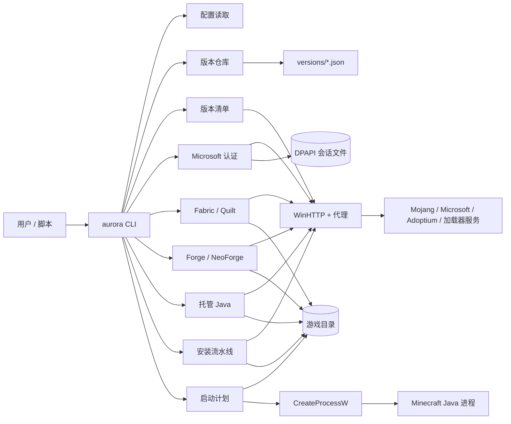
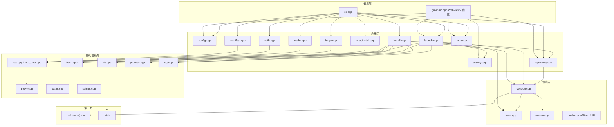
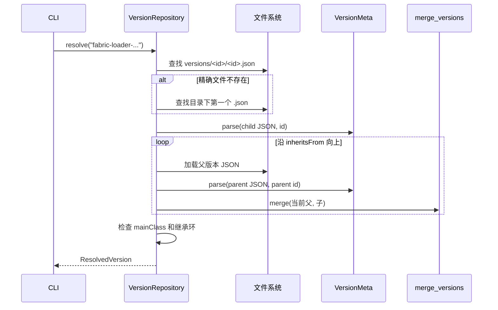
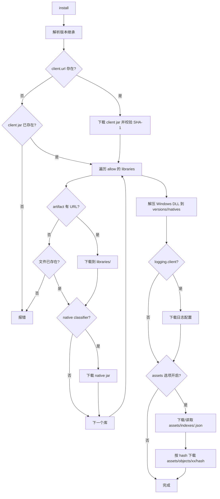
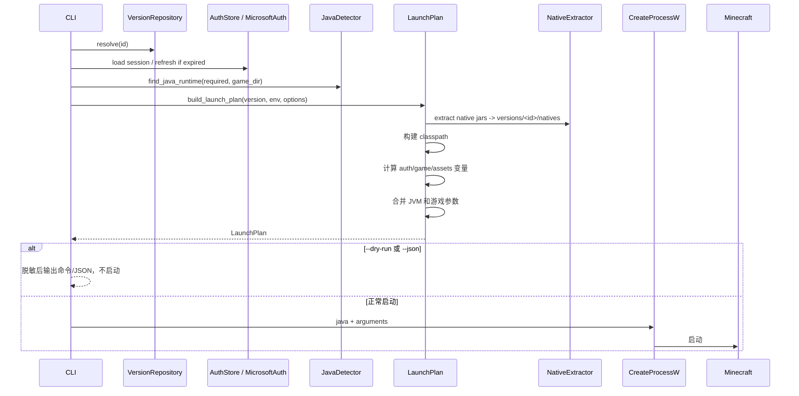
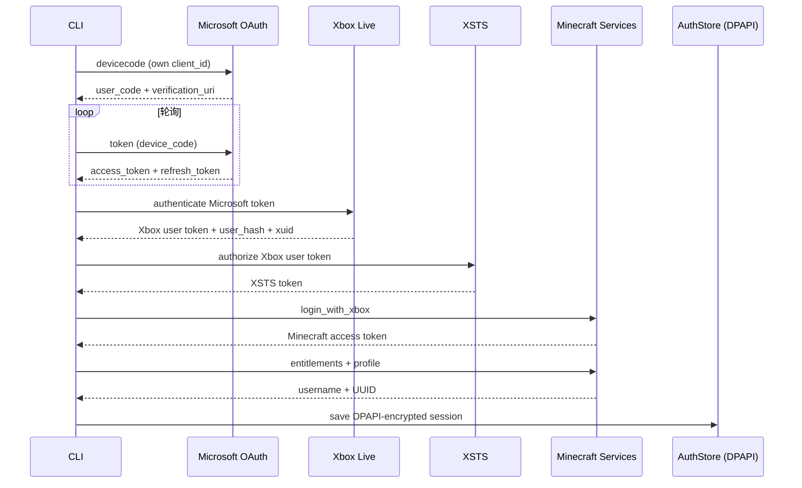
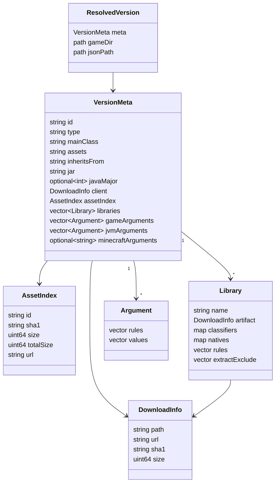

# AuroraLauncher C++ Core 架构

本文描述当前工作区中**已经实现的 C++ 核心**，不是 Java 版 HMCL/AuroraLauncher 的完整功能说明。原 Java 工程已归档到：

```text
D:\AuroraLauncher-archive\2026-10-26\HMCL-main
```

当前工程是 Windows-first 的启动核心，CLI 为完整功能面，GUI 覆盖浅色玻璃主页（左栏大版本号与启动胶囊、主卡最近游玩行内启动、底部统计与年度日历）、全页实例选择与全页实例设置（概览/设置/日志，含实例/存档/模组/日志文件夹快捷方式）。实例选择与实例设置沿用 PCL2 CE 的信息结构；主页骨架按用户提供的设计稿重排，视觉沿用 LauncherX 与美西螈启动器的浅色卡片语言。窗口为无边框自绘（4px 缩放入口、`DWMWA_BORDER_COLOR = NONE` 去掉 Win11 白边）。所有“已实现”描述都以本仓库源码为准；产品身份、OAuth 应用和签名边界见 `SIGNING.md`。

## 1. 状态定义

| 标记 | 含义 |
| --- | --- |
| 已实现 | 已有可编译、可运行的代码路径，并有单元测试或现场 CLI 验证 |
| 部分实现 | 主路径存在，但缺少边界处理、平台支持或完整现场验证 |
| 未接入 | 只有接口、文档或占位，没有端到端能力 |

## 2. 系统上下文



边界：

- 输入是用户已有的 `.minecraft` 目录；版本 JSON 可由 `version fetch` 显式从 Mojang 清单获取，`--no-fetch` 可关闭该行为。
- Microsoft 登录只使用项目自己的 Azure 应用 client ID；未配置时拒绝登录，不冒用其他启动器。
- Forge/NeoForge 使用官方 installer；本项目不重新实现其处理器逻辑，也不在启动时隐式联网。
- Modrinth/CurseForge 模组搜索、安装、启停、指纹/哈希更新检查，以及可启动整合包实例、升级备份、资源包兼容性管理已接入；主题包和服务端模块不在当前边界内，GUI 目前覆盖主页与实例页。

## 3. 分层与模块



关键文件：

| 文件 | 职责 |
| --- | --- |
| `src/cli.cpp` | 命令、参数、JSON/文本输出、敏感参数脱敏 |
| `src/gui/main.cpp` | WebView2 宿主、JS↔C++ JSON 消息桥、进程轮询与日志尾部推送 |
| `src/gui/ui/index.html` | 浅色玻璃主页（左栏大版本号与启动胶囊、最近游玩行内启动、统计、年度热力图）、实例选择页与实例设置页（单文件 HTML/CSS/JS，无前端构建步骤） |
| `src/core/repository.cpp` | 扫描 `versions`，加载并递归解析 `inheritsFrom` |
| `src/core/version.cpp` | 版本 JSON 模型、库、参数、下载信息、合并规则 |
| `src/core/rules.cpp` | OS/arch/version/features 规则判断 |
| `src/core/manifest.cpp` | Mojang 版本清单解析与版本 JSON 下载 |
| `src/core/maven.cpp` | Maven 坐标转换和相对路径 |
| `src/core/java.cpp` | Windows Java 候选发现、`release` 解析、托管运行时扫描 |
| `src/core/java_install.cpp` | Adoptium API、SHA-256、ZIP 解压与原子安装 |
| `src/core/install.cpp` | 客户端、库、natives、资源索引和资源对象下载 |
| `src/core/launch.cpp` | 类路径、变量替换、JVM/游戏参数、启动计划；阻塞启动结束时记录游玩会话 |
| `src/core/activity.cpp` | 游玩会话写入 `activity.json`、按天聚合、从启动横幅回填历史启动 |
| `src/core/auth.cpp` | 设备码、Xbox Live、XSTS、Minecraft 登录、DPAPI 存储 |
| `src/core/loader.cpp` | Fabric/Quilt 元数据查询和 profile JSON 安装 |
| `src/core/forge.cpp` | Forge/NeoForge 版本查询、installer 下载/校验/执行、产物定位 |
| `src/core/http.cpp` | WinHTTP GET、重试、镜像回退、断点续传 |
| `src/core/mirrors.cpp` | BMCLAPI/MCIM URL 映射、分 provider 镜像健康状态和候选顺序 |
| `src/core/modrinth.cpp` | Modrinth 搜索、版本/依赖选择、模组安装/更新与 SHA-1 校验 |
| `src/core/mods.cpp` | 本地 mods 目录扫描、`.jar`/`.jar.disabled` 启用与禁用、jar 元数据读取 |
| `src/core/curseforge.cpp` | CurseForge API 搜索、文件选择、依赖递归、下载校验、fingerprint 匹配与更新检查 |
| `src/core/modpack.cpp` | Modrinth/CurseForge 整合包解析、加载器/游戏安装、实例 JSON、overrides 哈希与升级备份 |
| `src/core/resourcepacks.cpp` | 资源包扫描、pack.mcmeta 兼容性、新旧 `options.txt` 格式与启停 |
| `src/core/pcl.cpp` | PCL 实例设置（`Setup.ini`/`config.v1.yml`）、版本隔离判定、内存档位与参数拆分 |
| `src/core/http_post.cpp` | WinHTTP GET/POST 带自定义头（认证、CurseForge fingerprint） |
| `src/core/proxy.cpp` | 环境变量与 WinINET/PAC 代理解析 |
| `src/core/zip.cpp` | miniz 解压，带路径穿越防护 |
| `src/core/hash.cpp` | BCrypt SHA-1/SHA-256/MD5、文件哈希、离线 UUID |
| `src/core/process.cpp` | `CreateProcessW` 启动、等待、输出重定向 |
| `src/core/config.cpp` | `%APPDATA%\AuroraLauncher\config.json` |

GUI 宿主要点：顶层窗口用 `WS_POPUP | WS_THICKFRAME` + `WS_EX_APPWINDOW`，`WM_NCCALCSIZE` 返回 0 去掉原生标题栏；`WM_NCHITTEST` 在四边 6px 内返回缩放命中码，`WM_GETMINMAXINFO` 把最大化限制在显示器工作区；窗口创建后按工作区居中，并用 `DwmSetWindowAttribute(33)` 在 Windows 11 上取圆角。WebView2 的 bounds 向内缩 4px（`k_resize_border`），保证边缘缩放由父窗口命中；父窗口 `WM_ERASEBKGND` 只绘制这条可见边框——顶部按 DPI 缩放的 48px 标题栏高度刷成蓝色，其余刷深色，使标题栏看起来铺满窗口。标题栏拖动由页面 `mousedown` 发 `window/drag` 消息，宿主 `ReleaseCapture()` 后投递 `WM_NCLBUTTONDOWN(HTCAPTION)`；最大化/还原/最小化/关闭同理。UI 通过 `SetVirtualHostNameToFolderMapping("aurora.ui")` 加载，启动前用 CDP 关闭 HTTP 缓存，避免升级后仍加载旧 `index.html`。

## 4. 版本解析



实现细节：

- `versions/<id>/<id>.json` 优先；找不到时使用目录中按文件名排序的第一个 `.json`。
- 继承链按“最底层父版本 → 子版本”合并。
- 子版本非空字段覆盖父版本；库按 `name` 去重，子版本同坐标替换父版本。
- 游戏参数和 JVM 参数按父 → 子追加。
- `assetIndex`、`client`、`javaVersion.majorVersion` 子版本优先。
- 合并后把版本 id 固定为请求的目录 id，避免 JSON 内部 id 与目录名不一致。
- 继承环会报错，不会无限递归。

## 5. 版本清单与安装流水线

`version fetch` 先拉取 Mojang `version_manifest_v2.json`，按 id 找到条目，下载并校验版本 JSON 到 `versions/<id>/<id>.json`。`install` 和 `launch --install` 在本地缺少版本 JSON 时也会走同一路径；显式 `--no-fetch` 可禁止联网。



实现范围：

- 并行资源下载使用最多 8 个工作线程；库下载当前串行。
- 所有带 SHA-1 的下载都会校验；已存在且哈希一致的文件会跳过。
- 资源对象 URL 固定为 `https://resources.download.minecraft.net/<前两位>/<hash>`。
- 下载候选顺序为：内置镜像（BMCLAPI / MCIM）→ `--mirror`/配置中的额外 URL → 官方 URL。
- 镜像在本次进程中失败或响应过慢后会被跳过；文本 GET 用短超时与官方源竞速，文件下载在镜像源上使用更短超时并在失败后回退。
- Microsoft/Xbox/Minecraft 认证、entitlements 和 Adoptium API 不参与镜像重写。
- 下载支持重试、指数退避、`Retry-After` 和 `.part` 断点续传；跨源切换会丢弃上一源的半成品。
- 支持旧版资源索引的 `virtual`/`map_to_resources`：安装时复制到 `assets/virtual/<index>/` 或 `<game>/resources/`，启动时把 `game_assets` 指向实际目录。
- 版本 `logging.client` 配置文件会下载并在启动命令中注入。

## 6. 启动流水线



模板变量支持：

`auth_player_name`、`version_name`、`game_directory`、`assets_root`、`game_assets`、`assets_index_name`、`auth_uuid`、`auth_access_token`、`auth_session`、`clientid`、`auth_xuid`、`user_type`、`version_type`、`natives_directory`、`launcher_name`、`launcher_version`、`classpath`、`classpath_separator`、`library_directory`、`resolution_width`、`resolution_height`、`user_properties`。

参数策略：

- 优先使用版本 JSON 的 `arguments.jvm` / `arguments.game`。
- 没有 `arguments` 时回退到旧版 `minecraftArguments` 字符串。
- 总是加入内存参数和 `-Dfile.encoding=UTF-8`。
- 缺少 `-Djava.library.path`、`-cp`/`-classpath` 时补默认值。
- 离线启动使用 `auth_access_token=0`、`user_type=legacy` 和离线 UUID。
- 正版启动使用 Microsoft 会话的 access token、Minecraft UUID、`user_type=msa`，并在可用时附加 `xuid` / `clientId`。
- 启动进程不再记录命令行；`--dry-run` / `--json` 会对 `--accessToken`、`--session` 及其 `=` 形式脱敏。
- Java 选择同时扫描系统 JDK 和 `<game-dir>/runtime/java` 下的托管运行时。

## 7. Microsoft 认证



- OAuth client ID 必须由调用方提供，代码中没有内置任何启动器的 client ID。
- 刷新令牌和 Minecraft 会话写入 `%APPDATA%\AuroraLauncher\auth.dat`，使用当前 Windows 用户的 DPAPI 加密；不能跨用户/机器解密。
- 会话过期时 `launch` 会尝试用 refresh token 刷新；刷新失败则要求重新登录或使用 `--offline`。
- 设备码、访问令牌和刷新令牌不会打印；`auth status --json` 只输出用户名、UUID、类型和过期时间。

## 8. 加载器与托管 Java

### Fabric / Quilt

- 查询元数据：Fabric v2 / Quilt v3 loader 列表，选择 stable 或 latest。
- 下载官方 profile JSON，校验 `id`、`inheritsFrom`、`mainClass`、`libraries`，把 `id` 改写为本地确定性 id（如 `fabric-loader-0.16.10-1.21.1`）。
- 写入 `versions/<id>/<id>.json`；默认不覆盖已有文件，`--force` 才覆盖。
- 生成的版本沿用现有 `inheritsFrom` 合并、安装和启动流程，不需要额外的加载器注入器。

### Forge / NeoForge

- Forge 版本先查 BMCL `/forge/promos`（数组 schema，按 `name`/`build` 解析并保留每通道最新构建），失败或无匹配时回退官方 `promotions_slim.json`；NeoForge 先查 BMCL `/neoforge/list/<mc>`，失败或无匹配时回退官方 Maven `maven-metadata.xml`。元数据请求使用短超时，不参与下载镜像健康状态。
- 下载官方 installer JAR，优先读取 Maven `.sha1` sidecar 校验；没有 sidecar 时必须显式 `--allow-unverified` 才能执行。
- 执行前验证 JAR 布局（manifest/install_profile/version），以 `-Djava.awt.headless=true -Djava.net.useSystemProxies=true -jar <installer> --installClient <game>` 运行，stdin 指向 NUL，stdout/stderr 写入日志。
- 安装后扫描 `versions/*/*.json`，按 `inheritsFrom`、`mainClass` 和加载器版本定位产物；不会把安装器输出当成成功，退出码和产物都要验证。

### 模组、资源包与整合包

- 本地模组：扫描 `mods` 的 `.jar`/`.jar.disabled`，启停是目录内原子重命名；大小写不同的同名文件视为冲突。元数据按 `fabric.mod.json`、`quilt.mod.json`、`META-INF/neoforge.mods.toml`、`META-INF/mods.toml`、`mcmod.info`、`litemod.json` 的顺序读取名称、版本、作者和加载器。
- 更新检查：对本地 jar 计算 SHA-1，逐个查询 Modrinth `/v2/version_file/<sha1>`；404 视为“不在 Modrinth”，单文件失败不会中断整批。`--apply` 下载最新 release、校验 SHA-1，成功后才删除旧 jar，并保留禁用状态。
- CurseForge：用户 API key 只放在 `x-api-key` 请求头；搜索固定 gameId 432/classId 6，文件按 loader + gameVersion 过滤，只跟随 required 依赖；没有 `downloadUrl` 的文件直接拒绝。本地识别使用 HMCL 同款 fingerprint：去除 `0x09/0x0A/0x0D/0x20` 后计算 MurmurHash2（seed 1），批量 POST `/v1/fingerprints/432`；`curseforge update` 用项目文件列表判断更新，`--apply` 保留禁用状态并先校验新文件。
- 资源包：扫描 `resourcepacks` 下的 `.zip` 和目录，读取 `pack.mcmeta` 的 `pack_format`/`supported_formats`/`min_format`/`max_format` 与 `pack.png`；按游戏资源格式判断兼容性并同步 `incompatibleResourcePacks`。1.13+ 写 `file/<name>`，旧版本写裸文件名；其他 options 行、CRLF/LF 和末尾换行保持不变。
- 整合包：读取 `.mrpack` 的 `modrinth.index.json` 或 CurseForge `manifest.json`，下载并校验 SHA-1。安装到 `versions/<id>`（默认 id 为包名），自动安装加载器（Fabric/Quilt profile；Forge/NeoForge 官方 installer）、下载客户端/库/资源，并生成继承加载器的版本 JSON。`launch` 读到 `modpack.json` 后把该目录作为运行目录，模组、资源包、options 相互隔离。
- 整合包升级：`modpack.json` 记录每个 mod 与 override 的相对路径和 SHA-1；新包中新增的 override 覆盖，用户修改过的保留，用户删除的保持缺失，新包删除的 override 和 CurseForge 新 manifest 中不存在的旧文件会删除。升级前复制实例到 `<game-dir>/backup/<id>-<时间戳>`，失败时恢复。

### PCL 实例兼容

- 读取 `versions/<id>/PCL/config.v1.yml`（PCL CE）或 `PCL/Setup.ini`（旧版）的扁平键值，忽略注释、引号和 BOM。
- 隔离：`VersionArgumentIndieV2` 显式布尔优先，其次 `VersionArgumentIndie`（1 开、2 关）；都没有时按 PCL 规则自动判断——`mods` 下有文件或 `saves` 下有世界目录即隔离。
- 隔离实例的启动工作目录切到 `versions/<id>`，`run_dir` 同时用于资源包、模组和整合包命令；未隔离实例继续使用共享游戏目录。
- 内存：`VersionRamType` 为手动（1）时按 PCL 档位换算——≤12：`tick×0.1+0.3`；13–25：`(tick−12)×0.5+1.5`；26–33：`(tick−25)+8`；>33：`(tick−33)×2+16`（单位 GB）；`VersionRamCustom` 缺省用 PCL 默认档位 15。自动（0）和跟随全局（2）沿用全局配置。
- `VersionAdvanceJvm`/`VersionAdvanceGame` 按引号规则拆分后作为额外参数，支持 `${library_directory}` 等 JSON 替换标记；留空时沿用全局参数（与 PCL 一致）。
- `VersionArgumentJavaSelect` 同时支持旧版的裸路径和 PCL CE 的 JSON 偏好（`kind` 为 `exist`/`relative`/`auto`/`global`）；路径不存在或偏好为自动/全局时回退到配置和运行时检测。

### 托管 Java

- Adoptium latest API 选择 Windows x64 JDK；校验 SHA-256 和大小，miniz 解压，拒绝路径穿越。
- 先解压到 `.staging-*`，验证 `bin/java.exe` 和 `release` 后再原子替换到 `<game-dir>/runtime/java/<jdk>`；失败保留原运行时。
- `java install` 默认 Java 21；`--force` 才替换已有同版本运行时。

## 9. 数据模型



路径约定：

```text
%APPDATA%/AuroraLauncher/
  config.json                     # 用户设置
  activity.json                   # 游玩会话（实例 id、本地开始时间、秒数）
  WebView2/                       # WebView2 用户数据
<gameDir>/
  versions/<id>/<id>.json
  versions/<id>/<id>.jar          # client jar；版本 JSON 的 jar 字段可覆盖名字
  versions/<id>/natives/          # 原生 DLL 解压目录
  libraries/                      # Maven 布局
  assets/indexes/<index>.json
  assets/objects/<xx>/<sha1>
  runtime/java/<jdk>/             # 托管 Java
  .aurora/forge/                  # Forge/NeoForge installer 和日志
```

## 10. 当前实现状态

| 模块 | 状态 | 备注 |
| --- | --- | --- |
| CLI | 已实现 | 版本、Java、加载器、Forge、Modrinth、CurseForge、模组/资源包/整合包、认证、安装、启动、配置 |
| 配置 | 已实现（基础） | JSON 读写；相对路径按当前工作目录解析 |
| 版本仓库 | 已实现 | 本地 JSON、继承、环检测 |
| 版本清单 | 已实现 | Mojang 清单、版本 JSON 下载与 SHA-1 |
| 规则 | 已实现 | Windows/OSX/Linux、arch、features、版本正则 |
| Java 检测 | 已实现（Windows） | 注册表、JAVA_HOME、PATH、常见目录、托管运行时 |
| 托管 Java 安装 | 已实现 | Adoptium、SHA-256、原子替换；真实大包下载待现场验证 |
| 离线登录 | 已实现 | 离线 UUID 和 legacy 参数 |
| Microsoft 登录 | 已实现（需自有 client ID） | 设备码/Xbox/XSTS/Minecraft + DPAPI；现场登录待验证 |
| 下载 | 已实现 | 镜像优先/官方回退；重试、退避、断点续传、代理、SHA-1 |
| 安装 | 部分实现 | 客户端/库/natives/objects/logging；无 virtual assets |
| 原生库解压 | 已实现（Windows） | 只解压 `.dll` |
| 启动 | 已实现（真启动验证） | 离线/正版参数、启动计划、进程启动；原版与 Fabric 实例实跑到主界面 |
| Fabric / Quilt | 已实现 | 元数据与 profile 安装；API 现场连通性受网络影响 |
| Forge / NeoForge | 已实现（installer bridge） | 官方 installer；真实安装/启动待现场验证 |
| Modrinth 模组 | 已实现 | 搜索、版本选择、必需依赖递归、SHA-1；MCIM API 镜像 |
| 本地模组管理 | 已实现 | 扫描 `.jar`/`.jar.disabled`、jar 元数据、启用/禁用、Modrinth SHA-1 更新检查与 `--apply` 替换 |
| CurseForge 模组 | 已实现（需用户 API key） | 搜索、文件选择、必需依赖递归、SHA-1、fingerprint 匹配与更新检查；无 `downloadUrl` 时拒绝 |
| 资源包管理 | 已实现 | `resourcepacks` 扫描、pack.mcmeta 兼容性、新旧 options 格式与启停 |
| 整合包 | 已实现 | `.mrpack` / CurseForge manifest、自动加载器、可启动实例、overrides 哈希、升级/备份 |
| PCL 实例兼容 | 已实现 | `Setup.ini`/`config.v1.yml`、版本隔离、内存档位、JVM/游戏参数、指定 Java；`launch` 与 `run_dir` 自动采用 |
| 自签开发签名 | 已实现 | 脚本 + Windows 资源/清单；公开发布需可信证书 |
| GUI | 主页与实例页已实现 | WebView2 宿主 + 无边框浅色窗口（自绘标题栏、状态胶囊、拖动/缩放/最大化/最小化、无 DWM 白边）+ 主页（左栏大版本号与启动/停止胶囊、最近游玩行内启动、统计、年度热力图）+ 全页实例选择（文件夹侧栏、搜索、行内齿轮）+ 全页实例设置（概览/设置/日志、打开实例/存档/模组/日志文件夹）；下载与安装仍在 CLI |
| 游玩活动 | 已实现 | GUI 与 CLI 启动都写入 `activity.json`；热力图还会读取各实例 `logs/aurora-launcher.log` 的启动横幅回填旧启动 |
| 主题包/服务端 | 未接入 | 原 Java 功能尚未迁移 |

## 11. 关键设计决策

1. **先核心、后 UI**：CLI 直接复用未来 GUI 会调用的模块，避免先做界面后补核心。
2. **显式网络行为**：版本清单只在 `version fetch`、`install` 缺少本地 JSON 或显式允许时拉取；`--no-fetch` 可完全关闭。Forge/NeoForge 安装器只在显式命令中执行。
3. **显式下载模型**：`DownloadInfo` 保留 URL、SHA-1、size、Maven path；安装器只根据模型执行。
4. **继承在内存中合并**：不修改原始 JSON；每次解析得到独立 `VersionMeta`。
5. **自有身份**：产品名、User-Agent、配置目录、启动器品牌和 OAuth 应用 ID 都是 AuroraLauncher 自己的，不使用其他启动器的身份。
6. **Windows 原生基础设施**：WinHTTP、BCrypt、DPAPI、`CreateProcessW`、注册表；代价是跨平台移植成本。
7. **第三方安装器只做编排**：Forge/NeoForge 的处理器逻辑交给官方 installer，项目只负责选择版本、校验下载、执行和验证产物。

## 12. 风险

### P0

- **令牌泄露**：Minecraft access token 会出现在子进程命令行中，这是 Minecraft 协议决定的；项目已避免记录命令行、对 dry-run JSON 脱敏，`run_process` 的输出日志头部只写可执行文件路径、绝不写参数（有回归测试覆盖），但同一用户下的进程查看工具仍可能读取命令行。不得把令牌写入日志、崩溃报告或配置。
- **第三方 installer 执行**：Forge/NeoForge installer 是第三方代码。默认要求 SHA-1 sidecar；`--allow-unverified` 是显式的风险开关。安装器仍会以当前用户权限运行，不能视为沙箱。
- **路径与命令注入**：启动参数通过 `quote_windows_arg` 拼接；库/客户端/资源相对路径和 ZIP 条目已有绝对路径、盘符、`..`、尾随点/空格检查。新增写入路径必须走 containment 检查。
- **OAuth 身份**：不能使用 HMCL 或其他启动器的 client ID；发布前必须注册项目自己的 Azure 应用。
- **CurseForge API key**：用户 key 只通过请求头发往 `api.curseforge.com`，不写入日志；`config show` 显示 `<set>`。配置文件和普通 JSON 一样是明文，用户需自行保护该文件。

### P1

- **镜像元数据可信度**：版本清单和版本 JSON 本身没有签名，镜像可以返回与官方不同的元数据；文件 SHA-1 只能保证与镜像给出的摘要一致。
- **模组代码信任**：Modrinth/CurseForge 只保证文件完整性和元数据一致；mod jar 会在 Minecraft 进程内以当前用户权限执行，没有静态扫描或沙箱。
- **整合包覆盖**：首次安装按 HMCL 语义覆盖同名 overrides；升级时用户修改过的文件保留，用户删除的文件不会被恢复，`--force` 强制覆盖。整合包内容可写实例目录下的任意相对路径（仍拒绝绝对路径、`..`、ADS 和 Windows 保留名）。
- **未现场验证**：Microsoft 登录、Forge/NeoForge 完整安装还没有端到端验证；原版 1.19.2 与 Fabric 1.19.4 实例的真实游戏启动已实跑通过（离线账号，到达主界面）。Fabric 元数据已通过镜像实测，Quilt 官方 API 在本机超时。Modrinth 搜索、安装、启停和更新已现场验证；CurseForge 验证了请求路径、403 映射、fingerprint 测试向量与注入式更新流程，有效 key 下的搜索/安装待验证。整合包自动加载器已用空包 + Fabric 实测（`--no-game`），完整整合包下载后真启动尚未串联验证。
- **命令行长度**：没有 argfile/classpath manifest；大量模组导致命令行超过 Windows 限制时会启动失败。
- **Java 选择**：只按 major 选择最低可用版本；没有厂商/位数/内存参数兼容性判断。
- **FIPS/BCrypt**：离线 UUID 使用 BCrypt MD5；在禁用 MD5 的 FIPS 策略下可能失败。
- **并发下载错误**：资源下载并发时只保留第一个错误；部分线程可能已经写入临时文件。
- **代理与 TLS**：系统代理/PAC 已支持；如果代理使用自签 CA，需由系统证书存储信任，项目不做证书校验绕过。
- **配置路径**：相对路径按当前工作目录解析，没有按配置文件所在目录解析。

### P2

- 没有结构化日志文件轮转；`--verbose` 只影响 stderr。
- 没有下载进度条；资源下载只每 250 个输出一次。
- 没有 CLI 自动补全、国际化、退出码细分。
- 没有 CMake install/打包规则；当前只产出 `build/<Config>/aurora.exe`。
- Java 安装尚未做 Adoptium 之外的厂商镜像选择。

## 13. 验证

已执行：

```powershell
cmake -S . -B build -G "Visual Studio 17 2022" -A x64
cmake --build build --config Debug --parallel
ctest --test-dir build -C Debug --output-on-failure
```

结果：

- Debug 和 Release 编译通过；14 个测试目标全部通过：核心、HTTP、加载器、版本清单、认证、Java 安装、Forge/NeoForge、Modrinth、模组管理、CurseForge、资源包、整合包、PCL、活动记录。
- 现场联网：`version latest` 拉取 Mojang 清单成功；`forge list forge 1.21.1`（52.1.20）和 `forge list neoforge 1.21.1`（260 个版本，最新 21.1.265）经 BMCLAPI 元数据镜像成功，单次约 0.6 秒；`loader list fabric` 经 BMCLAPI 成功。
- Modrinth 现场联网：`mod search sodium` 经 MCIM API 镜像返回结果；`mod install sodium` 和 `mod install sodium-extra` 完成下载、SHA-1 校验和 Sodium 依赖识别。
- 模组管理现场验证：`mod list`、`mod disable/enable` 在临时目录往返成功；安装 Sodium 0.6.0 后 `mod update` 报告 0.8.13 可用，`mod update --apply` 下载、校验并删除旧 JAR，再次检查为 up to date。
- CurseForge 现场验证：无 key 时拒绝并给出配置提示；无效 key 请求返回 HTTP 403，错误信息不含 key。有效 key 下的完整搜索/安装未执行。
- 资源包现场验证：`resourcepack list/enable/disable` 往返成功，`options.txt` 其他行与 CRLF 保留；pack.mcmeta、新旧 options 格式和 incompatible 列表有测试覆盖。
- 整合包现场验证：自建 `.mrpack` 引用真实 Sodium 下载地址安装成功，SHA-1 匹配，client overrides 覆盖 base overrides；空包实测 Fabric 加载器自动安装并生成实例 JSON（`--no-game`）。升级、备份、失败恢复、用户修改保留、用户删除保留和 CurseForge 旧文件删除有测试覆盖。
- CurseForge fingerprint 使用固定向量验证（`hello` → 0xa631918e，空白字节剔除），更新检查/替换使用注入响应验证。
- PCL 实例现场验证：合成 `PCL/Setup.ini`（隔离、内存 tick 25、`-Xss1M`、`--width 1280`、长路径 Java）下 `launch --dry-run --json` 的工作目录切到实例目录、内存 8192 MB、额外参数和 java 全部生效；`config.v1.yml`、自动隔离、显式关闭隔离、无效 Java 回退和参数引号拆分有测试覆盖。
- 启动计划测试覆盖空 `clientid`/`auth_xuid` 参数保留和单次变量替换。
- 真实游戏启动（离线账号）已从 `--dry-run` 走到进程实跑：从 `D:\PCL\.minecraft` 复制出 1.5 GB 独立冒烟目录，原版 1.19.2 到达 `Sound engine started`（LWJGL 3.3.1 build 7、OpenAL 初始化、无 crash-report/hs_err、干净 `Stopping!`）；真实 PCL CE 隔离实例 `1.19.4-Fabric_0.18.4` 的工作目录按 `VersionArgumentIndieV2: true` 切到 `versions/<id>`，日志 `Loading Minecraft 1.19.4 with Fabric Loader 0.18.4`、`Loading 9 mods`、Mixin `Service=Knot/Fabric Env=CLIENT`，`mod install sodium` 写入实例自己的 `mods` 后重启即出现 `sodium 0.4.10+build.24`。1.19.2/1.19.4 清单里 `natives` 映射为 0 条，LWJGL3 从类路径自解压，因此 `versions/<id>/natives` 为空是正确行为；旧版（≤1.16.x）的 natives 解压仍只有单测覆盖。
- 桌面 GUI 真机验证：界面为浅色玻璃主页 + 全页实例选择 + 全页实例设置（无边框自绘窗口、`WS_POPUP | WS_THICKFRAME`、自绘浅色标题栏与状态胶囊）。1180×760 居中窗口下用真实点击完成「主页 → 实例选择 → 实例设置（概览/设置/日志）→ 启动 → 停止」。窗口交互实测：拖动标题栏、4px 边缘缩放、最大化到工作区 1920×1032（任务栏保留）并还原 1180×760、最小尺寸钳制 980×620（请求 800×500 无效）；窗口四边逐像素抽样为 #EEF1F6（左/右/下 4px）与 #FAFBFD（上），`DWMWA_BORDER_COLOR = DWMWA_COLOR_NONE` 后没有纯白边框。启动后主胶囊与状态胶囊变绿「停止游戏 / 运行中 · 1.19.4-Fabric_0.18.4」，最近行内按钮变「停止」、另一行禁用；日志滚动到 LWJGL/资源加载行；停止后状态「已手动停止」，`activity.json` 写入会话，统计变为「4 分钟 / 10 次（今天 5 次）」。实例设置的「存档文件夹」用 `ShellExecuteW` 拉起资源管理器到 `versions/<id>/saves`，验证后关闭。页面切换（190ms 位移淡入）与设置页签切换（170ms 上移淡入）均在 70ms 中间帧截到位移；实例选择的搜索过滤与无匹配空态、返回上一页的 `anim-left` 均已验证。草方块图标与玩家头像在运行时从用户自己的客户端 JAR 读取纹理并用 canvas 合成，仓库不附带 Mojang 素材；背景图由本项目生成。热力图通过 JS 按卡片宽度计算格子尺寸，980×620 最小窗口到 1920 最大化下星期标签与格子均对齐。页面截图与 DOM 自检走 WebView2 CDP（`Page.captureScreenshot`），避免窗口被遮挡时截到其他程序。
- `launch --log FILE` 实测捕获子进程输出（50 条 log4j 事件 + JVM 的 `JDK_JAVA_OPTIONS` 提示），并确认头部不含参数：`--accessToken`/`-cp` 命中 0 次；`test_process_log_redacts_command_line` 用 `cmd.exe /c echo` 断言日志里有子进程输出但没有命令行片段。
- 路径安全测试覆盖绝对路径、盘符、`..`、ADS/冒号和危险尾随点/空格。
- 使用归档中的 `1.0` 版本执行了 `version list`、`version show` 和 `launch --dry-run`；中文路径、用户名和版本 id 已验证。
- 使用本地临时 HTTP 服务验证了客户端 JAR、库、资源索引和 native ZIP 下载，以及 SHA-1 校验、`.part` 文件、`extract.exclude` 和 `.dll` 解压。
- 未执行 Microsoft 登录和完整 Forge/NeoForge 安装；真实游戏启动与桌面首屏 GUI 已按上文验证。
- 本机代理对 `meta.fabricmc.net`、`maven.neoforged.net` 的连通性不稳定；Fabric/NeoForge/Forge promotions 的官方端点已实现并由单测覆盖，现场查询走 BMCL 镜像。

## 14. 后续阶段

1. **GUI**：主页（左栏版本号与启动胶囊、最近游玩、统计/热力图）、全页实例选择与全页实例设置已用 WebView2 落地；后续按页面补齐下载进度、整合包与设置向导，仍不引入 Qt 或前端构建链。
2. **CurseForge 完善**：依赖关系展示、有效 key 下的真实现场验证。
3. **整合包完善**：完整游戏文件下载与真实启动的端到端验证、实例级配置编辑。
4. **资源包完善**：下载源、光影包统一管理。
5. **服务端/更新器**：服务端启动、更新检查、崩溃分析。
6. **兼容层**：旧版 `virtual`/`map_to_resources` 资源、主题包、其他原 HMCL 功能。
7. **发布工程**：可信代码签名、CI 构建、安装包和自动更新。

在完成第 1～5 阶段前，不应把当前工程描述为“完整替代原启动器”。
