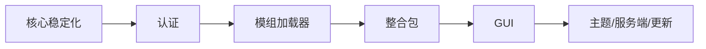

# Java → C++ 迁移矩阵

基准是归档中的 Java 工程：

```text
D:\AuroraLauncher-archive\2026-10-26\HMCL-main
```

状态：

- **完成**：C++ 中已有端到端实现并经过基础测试/CLI 验证。
- **部分**：主路径存在，但缺少边界、平台或完整产品能力。
- **未开始**：C++ 中没有实现，或只有文档/接口占位。
- **不迁移**：明确放弃的旧实现。

## 1. 启动核心

| 原 Java 能力 | C++ 状态 | 说明 |
| --- | --- | --- |
| 读取 `versions/<id>/<id>.json` | 完成 | 支持同目录其他 `.json` 文件名 |
| `inheritsFrom` 继承 | 完成 | 递归合并、循环检测 |
| 库规则（OS/arch/features） | 完成 | 规则顺序按 Mojang 语义 |
| Maven 坐标/路径 | 完成 | classifier、`@ext` |
| 下载客户端 JAR | 完成 | URL + SHA-1 |
| 下载 libraries | 完成 | 仅 artifact；串行 |
| 下载 natives | 完成 | classifier + SHA-1 |
| 解压 natives | 完成（Windows） | 仅 `.dll`；已应用 `extract.exclude` |
| 下载资源索引 | 完成 | SHA-1 |
| 下载 assets objects | 部分 | 8 线程；真实资源网络未验证 |
| 旧版 virtual assets | 未开始 | 影响旧版本 |
| 启动参数生成 | 完成 | `arguments` + 旧 `minecraftArguments` |
| 下载/注入 logging.client | 未开始 | 未处理 `logging.client` 文件和参数 |
| 启动进程 | 部分 | `CreateProcessW`；未做真实游戏启动验证 |
| 启动前自动修复文件 | 部分 | 需显式 `install` 或 `--install` |
| 启动失败诊断 | 未开始 | 仅返回退出码/错误 |
| 版本清单拉取 | 未开始 | 需要本地 JSON |
| 自动选择 Java | 部分 | 按 major 选最低可用；无 JRE 下载 |
| 内存/窗口配置 | 部分 | CLI/配置文件 |
| 游戏参数高级选项 | 部分 | 未迁移全部 HMCL 选项 |

## 2. 账号与认证

| 原能力 | C++ 状态 | 说明 |
| --- | --- | --- |
| 离线账号 | 完成 | 离线 UUID、access token `0` |
| Microsoft 登录 | 未开始 | 无 OAuth/设备码 |
| Xbox Live / XSTS | 未开始 | 无令牌交换 |
| 正版皮肤/档案 | 未开始 | 无 API |
| 刷新令牌持久化 | 未开始 | 无安全存储 |
| Authlib Injector / 外置登录 | 未开始 | 无 |
| 多账号管理 | 未开始 | 无 |

## 3. 模组与整合包

| 原能力 | C++ 状态 | 说明 |
| --- | --- | --- |
| Fabric/Quilt 安装 | 未开始 | 无 installer 解析 |
| Forge/NeoForge 安装 | 未开始 | 无 processor/installer |
| 模组依赖解析 | 未开始 | 无 |
| CurseForge 整合包 | 未开始 | 无 |
| Modrinth 整合包 | 未开始 | 无 |
| 资源包/光影包 | 未开始 | 无 |
| 模组更新/禁用 | 未开始 | 无 |

## 4. UI 与主题

| 原能力 | C++ 状态 | 说明 |
| --- | --- | --- |
| JavaFX 主窗口 | 未开始 | 当前只有 CLI |
| 页面导航/向导 | 未开始 | 无 |
| JFoenix 组件 | 不迁移 | 原 Java 工作树正在移除 JFoenix |
| CSS 主题包 | 未开始 | 无 |
| 深色/浅色模式 | 未开始 | 无 |
| 国际化 | 未开始 | CLI 英文，文档中文 |
| 下载进度 UI | 未开始 | 仅日志 |

## 5. 服务端与其他

| 原能力 | C++ 状态 | 说明 |
| --- | --- | --- |
| 服务端安装/启动 | 未开始 | 原 Java 服务端页面也未接入主入口 |
| 联机/房间 | 未开始 | 无 |
| 启动器自更新 | 未开始 | 无 |
| 崩溃分析 | 未开始 | 无 |
| 日志上传 | 未开始 | 无 |
| 多语言下载镜像 | 未开始 | URL 硬编码 |
| 代理设置 | 未开始 | 仅 WinHTTP 默认代理 |
| 便携模式 | 未开始 | 配置固定在 `%APPDATA%` |

## 6. 建议迁移顺序



### 阶段 1：核心稳定化

- 版本清单拉取和版本安装。
- virtual assets / `map_to_resources`。
- 下载重试、镜像、限速、代理。
- 更完整的 Java 选择（版本、位数、内存）。
- 结构化日志和退出码。

### 阶段 2：认证

- Microsoft OAuth 设备码。
- Xbox Live/XSTS/Minecraft 令牌链。
- 安全保存 refresh token。
- 正版/离线账号抽象统一。

### 阶段 3：模组加载器

- Fabric/Quilt JSON 安装。
- Forge/NeoForge installer processors。
- 启动参数注入和库合并。

### 阶段 4：整合包

- CurseForge/Modrinth 解析。
- 文件覆盖、依赖、下载源。
- 实例隔离。

### 阶段 5：GUI

- 在核心 API 稳定后选择 UI 框架。
- 先做版本列表/启动/下载/设置，再迁移高级页面。
- 主题包和 UI 动画最后处理。

## 7. 不应承诺的能力

在当前 C++ 代码状态下，不能声称：

- 可以替代 HMCL 的全部功能。
- 支持 Microsoft 正版登录。
- 可以直接安装 Forge/Fabric 整合包。
- 已有 GUI、主题、服务端管理。
- 已通过完整游戏启动、下载和 UI 测试。

这份矩阵会随着实现推进更新；状态以源码和测试为准，不以计划为准。
